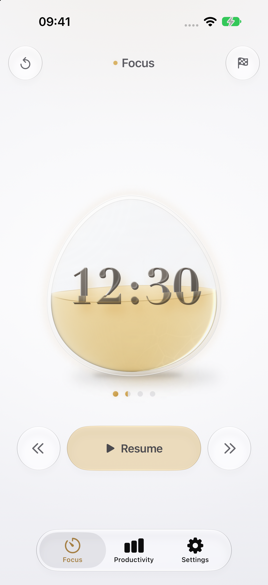
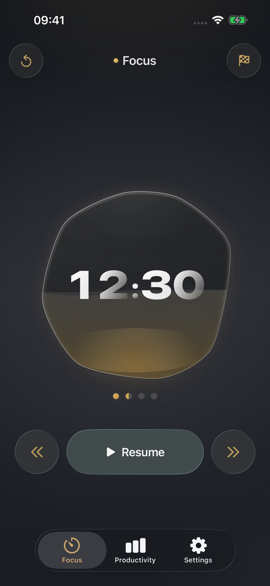
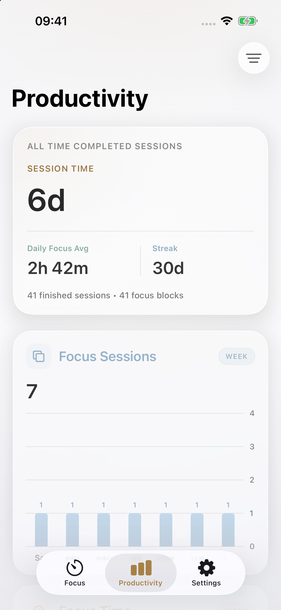
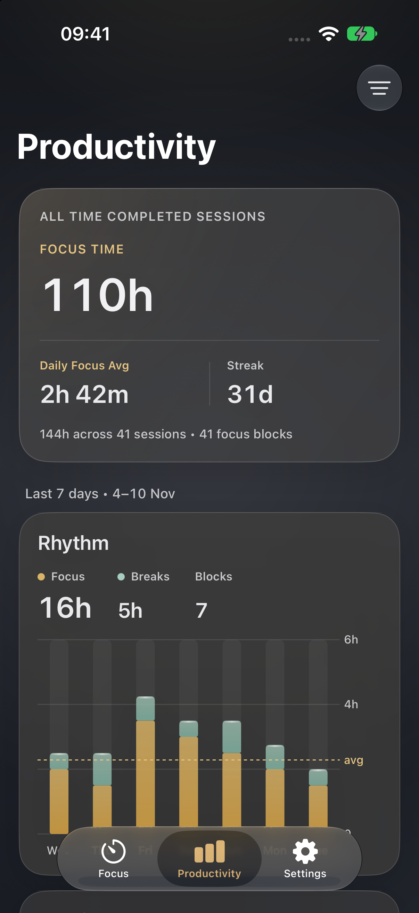
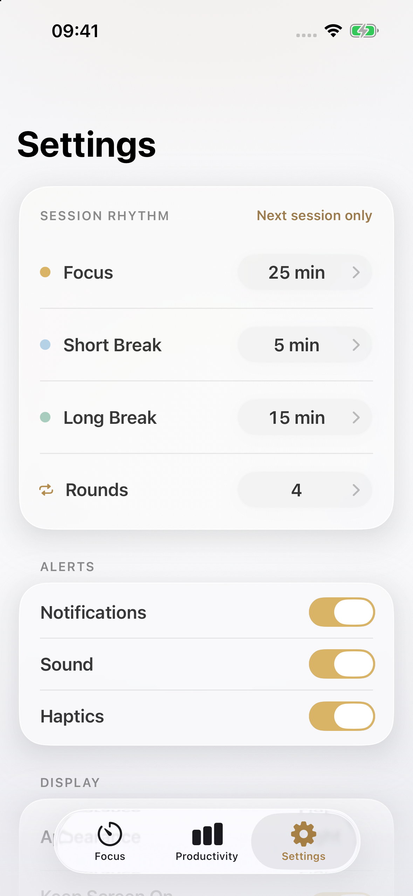
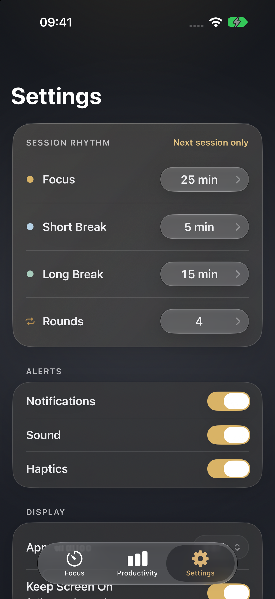

# Product Vision

VibePomodoro is a quiet Pomodoro timer for iOS. I want it to feel like a small object beside me: easy to read, easy to trust, and easy to leave alone once I start working.

This is a small project I am building with AI. I lead the product direction, interaction and visual decisions, acceptance criteria, and hands-on review. AI agents have written much of the implementation and helped with architecture, debugging, tests, and iteration. Working through those decisions is part of the project itself.

This document records the current product rules and the reasons behind them. Future ideas have their own section at the end. Setup and build instructions are in the [README](./README.md).

## Current scope

The active product is a native iOS app with three pages: **Focus**, **Productivity**, and **Settings**. The minimum deployment target is iOS 26.2. The earlier native macOS and Live Activity experiments are archived.

The app already supports timestamp-based timing, recovery after backgrounding or relaunch, focus and break cycles, early completion, a completion summary, local history, productivity charts, local notifications, event sounds, haptics, and appearance preferences. The **Send Feedback** and **Share App** rows in Settings are still marked **Soon**.

Settings, active sessions, completed sessions, and the statistics cache live on the device. Each device owns its active timer. Any future iCloud work is limited to completed sessions and explicitly selected settings. Active-session handoff, Handoff, and simultaneous timer control across devices remain outside the product scope.

SwiftData storage, iCloud sync, advanced analytics, imported sounds, and more elaborate reminder rules are future work. Animated numerals are a design exploration; the liquid bubble remains the current interface.

## The app today

These screenshots come from the built app on an iPhone 14 Pro simulator running iOS 26.4. Focus shows a paused demo session. Productivity uses generated test history. Both appearances use the same page structure and sample data.

| Page | Light | Dark |
| --- | :---: | :---: |
| Focus: timer, liquid progress, and controls |  |  |
| Productivity: all-time summary and recent trends |  |  |
| Settings: session rhythm and alert preferences |  |  |

Productivity and Settings scroll. These captures show the top of each page; more trend cards and settings continue below. The [screenshot notes](./docs/screenshots/README.md) record the capture environment and demo states.

## What the app should feel like

The app should be calm, warm, and dependable. Its visual character comes from transparency, light, gentle movement, and touch feedback. Everything still needs to be readable at a glance.

Six principles guide the design:

1. Put focus first.
2. Keep the core Focus experience on one screen.
3. Use native Liquid Glass navigation and controls where they fit.
4. Give movement and material a clear purpose.
5. Make statistics clear and honest.
6. Give the app one strong visual memory.

The bubble is that visual memory. The rest of the interface should support it. Gamified check-ins, high-pressure rewards, colorful icon walls, and decorative statistics would pull the app away from its purpose.

Use the system tab bar and navigation behavior. Focus may coordinate tab bar visibility through the shared shell when entering immersive mode. It should still feel like system navigation. Custom glass components should sit comfortably alongside native controls; heavy blur alone is not enough to establish the material.

## Session behavior

### Timing and recovery

Time comes from `Date` and `targetEndDate`. A running step derives its remaining duration from its end timestamp. Pausing records the elapsed segment and clears the end timestamp. Resuming creates a new end timestamp from the time left.

The screen may refresh every second, but a decreasing integer must never become the timer's source of truth. Backgrounding and locking the phone do not require the app to keep executing every second. When the app returns, it reconciles the session against real time, including any phase boundaries crossed while it was away. Relaunching restores the unfinished session.

### Rhythm

A session contains focus blocks and breaks. Each focus block is followed by a short break until the final round, which leads to a long break.

For four rounds, the sequence is:

```text
Focus -> Short Break -> Focus -> Short Break
      -> Focus -> Short Break -> Focus -> Long Break -> Session End
```

For one round, it is `Focus -> Long Break -> Session End`.

The normal sequence ends after the final long break. Skipping the final step or confirming **Finish early** also ends and archives the session. Only focus blocks that reach their full planned duration count as completed focus blocks.

### Controls

| Action | Behavior |
| --- | --- |
| Start | Begin the current step. |
| Pause | Record elapsed time and preserve the remaining duration. Paused time does not count. |
| Resume | Continue with a new `targetEndDate` based on the remaining duration. |
| Reset | Clear the current step's recorded time and restore its full duration. A running step immediately starts again; otherwise it returns to idle. |
| Skip | Record the current step's elapsed time and move forward once. Keep running if the timer was running; otherwise stay paused. Skipping an unfinished focus block does not add a completed round. |
| Back to last step | Clear the current and previous steps' recorded time and return to the previous step at full duration. Continue running if already running; otherwise return to paused or idle. On the first step, this acts as a reset. |
| Finish early | Available after some time has elapsed. Ask for confirmation, record the elapsed time, archive the session, and show the early-completion summary. |

An archived session can contain skipped or unfinished phases. Archiving never fills in time that did not happen or rounds that were not completed.

### Settings during a session

A session keeps the durations and round count chosen when it was created. Changes to the session rhythm apply to the next session. Appearance, notifications, sound, haptics, and screen-awake preferences take effect immediately.

Duration and round controls use fixed choices. A deliberate adjustment gives a gentle, clear haptic response. Normalizing an older saved value happens silently.

### Reminders and feedback

One phase ending and the next phase starting form a single boundary event. That event produces one response. The initial manual **Start** stays silent.

| Event | Sound | Foreground haptic |
| --- | --- | --- |
| Move forward, including Skip | `next-phase-whoosh.caf` | Soft impact |
| Back to last step | `phase-complete-pop.caf` | Rigid impact |
| Reset current step | `phase-reset-notification.caf` | Soft impact |
| Session complete | `session-complete-thud.caf` | Success |

A completion event uses the completion response on its own. In the background or while locked, local notifications carry the boundary or completion sound. The app does not try to drive haptics in the background. Settings adjustments use their own gentle haptic response.

## What Productivity counts

Productivity counts effective running time from archived sessions. Pauses are excluded. A session enters the charts when it ends, whether through the normal sequence, a final Skip, or confirmed early completion. An active session stays out of the formal totals and charts.

| Metric | Meaning |
| --- | --- |
| Focus Time | Recorded time in focus blocks. |
| Short Break Time | Recorded time in short breaks. |
| Long Break Time | Recorded time in long breaks. |
| Break Time | Short Break Time + Long Break Time. |
| Session Time | Focus Time + Break Time. |
| Completed Focus Count | Focus blocks that reached their full planned duration. |
| Daily Focus Avg | Total archived focus time divided by the number of calendar days with recorded focus time. Days with no focus record are excluded. |
| Streak | Consecutive days with archived focus time, counted backward from today. Until today has focus time of its own, the count starts from yesterday, so the streak holds through the day instead of reading zero every morning; it ends only after a whole day passes without focus. |

Time that crosses midnight is split across calendar days. Totals come from an aggregate cache derived from completed sessions. A session must enter that cache only once, even after relaunch or repeated reconciliation.

The range choices are rolling windows:

| Range | Window |
| --- | --- |
| Week | The last seven days, including today. |
| Month | The last 30 days, including today. |
| Year | The last 12 months, including the current month. |

Week and Month read daily aggregates and draw one bar per day; Year rolls daily values into calendar months. Display grouping must preserve the totals. Month does not merge days into weeks: thirty days never split evenly, and a short last group would read as a drop.

Skip keeps the time already spent without awarding an unfinished focus block. Reset clears the current step's recorded time. Back rolls back the affected steps. Those edits must carry through to the session's eventual archived statistics.

**Clear Productivity History** deletes both completed-session records and their aggregate cache. Productivity immediately returns to its empty state, and later sessions start a new history. The active session and settings remain intact.

With no archived history, the summary and charts show zero values alongside **No finished sessions yet**, and a short note says that sessions appear once they end, including ones finished early. Sample bars belong only in tests and clearly labeled documentation previews.

## Focus design

### The bubble

The bubble gives the timer a quiet physical presence. A conventional progress ring was considered, but the bubble better fits the feeling of a small companion object and gives the app a recognizable shape.

It should read as a stable glass container. A slightly rounded-square outline can give Focus some character; short and long breaks can use gentler contours. Across all three phases, the numerals stay centered, stable, and easy to read.

Use restrained edge refraction, highlights, inner shading, and soft caustic light. A subtle pool of light beneath the bubble can respond to the liquid surface. Native Liquid Glass is the first choice for system controls.

The bubble is drawn as a small glass vessel standing on the page rather than a shape floating over it. Its wall has visible thickness, so the liquid sits inside the glass instead of reaching the outline. One light comes from the top left: it catches the wall and the far edge of the liquid surface, and the vessel casts a soft shadow toward the lower right, with a tighter contact shadow where the glass meets the page. Inside that shadow, a caustic, the light the liquid focuses, brightens as the bubble fills and drifts gently with the surface. The caustic takes the liquid's tint and has no hard or white core, so on a dark page it reads as warm light in the shadow rather than a highlight. The custom bubble may use `UltraThinMaterial` with additional light and shading where needed.

Light and dark mode share the same geometry and material character. Adapt brightness, transparency, and contrast. Avoid separate visual identities for the two modes.

### Liquid and motion

The liquid gives a quiet sense of progress. Movement should be slow enough to leave alone. Pause holds it still; a phase change may have a short transition. During that transition the whole vessel changes together: outline, glass wall, glow, liquid, shadow, and phase color follow one shared progress, so no layer arrives at the next phase's shape before the outline does. The surface keeps moving through the change instead of restarting. Floating particle bubbles, spiral effects, and constant wobbling are outside this design.

Use two readable wave layers, including in light mode: the near and far edges of the liquid surface ride two different waves, which meet at the glass. On a light background, highlights alone disappear: there the glass edge needs a thin line and a soft phase-tinted ring, and the liquid is tinted from its surface down with a slightly deeper surface line, so the level reads at a glance in both appearances. The liquid's top is a surface seen slightly from above, an ellipse whose far edge catches the light and whose near edge is the water line. Both edges fade out toward the walls, so they read as light on the surface rather than outlines. The surface reaches the glass all the way around, with no pocket of air at its ends, and a faint meniscus catches the light where they meet.

The liquid's color comes from the light passing through it, not from a spot of light. It is shaded per pixel: the longer the light's path through the liquid, the more of the tint it takes, so the liquid is lighter near the glass and deeper in the middle, and less light reaches the lower part of a fuller vessel. The same rule covers both appearances, so light and dark mode do not need separate gradients. Light bent by the curved glass gathers along the wall away from the light. The surface mirrors its surroundings more toward its far edge and glints where the waves turn toward the light. Faint caustic threads drift low on the side away from the light and stay clear of the surface. Radial glows or pools of light inside the liquid are outside this design. The liquid must fill the inside of the glass wall without visible gaps at the top, sides, or bottom, and meet the glass the same way all around: the shader judges its distance to the glass both across and up and down, since the bottom and top run nearly level. The final fill should happen during the displayed `00:01` second: the container should visibly fill at the end without looking full several seconds early.

The countdown remains the most important information. Highlights, outlines, shadows, and glass shading must preserve its contrast, especially in light mode. The numerals sit inside the liquid. Above the wave line they keep their glass treatment and stay in front of the surface, so the surface never covers them. Below it they are seen through the liquid: tinted by it, magnified slightly by the round vessel, and bent a little by the waves near the surface. The break at the wave line stays a gentle kink, never a doubled digit. Only the dividing line and the refraction follow the waves; the numerals themselves still refresh once a second.

### Controls and layout

Keep all frequent actions on one screen. **Start / Pause / Resume** is the primary control beneath the bubble. Reset and Skip are secondary; Back is a quieter, less frequent action. Show Back only after timing has begun. Secondary controls appear only when they can act, and each keeps its slot so the primary control does not move; before a session starts, Focus shows only the bubble and **Start**, and after it ends, only the bubble's summary and **Done**.

Align the main controls with the bubble. Leave enough space beneath it for the group to feel balanced. The current controls sit low, near the upper edge of the tab bar, with a clear gap above system navigation.

The top row contains Reset, the status light and title, and Finish early. Keep it close to the top safe area and light enough to read as page navigation. Its buttons should feel comparable to system toolbar items. The title and light stay subordinate to the countdown.

Pause has a quiet, neutral appearance, so the bubble stays the strongest color while a step runs. Start, Resume, and Done carry a light wash of the current phase color. Reserve enough button width for the longest label, and keep the top and bottom icons consistent in weight. Use warm white control text and icons in dark mode and restrained dark foregrounds in light mode.

For the circular `.glass` controls, the button itself carries the visible glass circle. An outer slot owns its hit area and alignment. Keep custom pressed-opacity animations off the glass surface so they do not compete with system interaction feedback.

Back, Pause/Resume, and Skip must remain visibly separate during interaction. They may share a glass sampling region to reduce sampling changes, but `GlassEffectContainer` merging must be kept low enough to preserve each button's shape. Earlier flicker was traced to adjacent glass surfaces sampling independently; further work should start with their host and container structure.

### Status and round markers

The status vocabulary is `READY / FOCUS / SHORT BREAK / LONG BREAK`, and once a session has ended, **Session complete** or **Session finished**. During a session, the badge names the phase. The primary control communicates whether the timer can pause or resume. Let the badge width follow its content and keep its text on one line.

The strip beneath the bubble contains one marker per focus round. The current focus round uses a half-filled marker. Once the session moves past it, the marker fills only if that focus block reached its full planned duration; a block that was skipped or ended early keeps an outlined marker, matching what the statistics count. Future rounds stay subdued. Keep the strip compact, close to the status badge's height, so it connects the bubble to the controls without becoming a separate visual focus.

### Completion

A finished session stays on the Focus page rather than opening a separate view. The vessel keeps its place and becomes the summary: the countdown turns into the time spent focusing, under a small **FOCUSED** label, in the same numerals and liquid. The liquid comes to rest as full as the session's focus time came to its plan, just below the rim when the plan was met, and its surface goes calm. The status reads **Session complete**, or **Session finished** with a short note that what was done is kept. The round markers show which focus blocks were completed, and one line beneath them gives that count and the break time. Reset, Finish early, Back, and Skip step aside, and **Done** takes the primary control's place in the same glass family, with the phase color's wash. The tab bar stays hidden until Done.

When a session ends, everything changes in place: the controls change over first, the liquid settles from its final overfill, the countdown blurs into the total, and the breakdown arrives last. Nothing disappears and comes back, so there are no doubled frames and no empty page in between. Done drains the vessel to the next session's starting level while it morphs into the focus phase; the total blurs back into the countdown and Done becomes Start. With Reduce Motion enabled, the changes fade without movement.

### Changing duration

Dragging the main visual to change time is outside the MVP. It adds accidental gestures and complicates timing and statistics. The existing **Finish early** action handles ending sooner. If extending or adjusting time is explored later, explicit actions such as **+5 min** or **Adjust Duration** should come first.

## Productivity design

Productivity should help me understand my focus rhythm. Use clear bar charts, explainable values, and enough contrast to read them comfortably.

Keep the system large title and the range control in the trailing toolbar. The control is an icon-only `Menu` listing **Week / Month / Year** as toggles, so the system draws the checkmark beside the current choice at every text size; a checkmark image in a button's label disappears at accessibility sizes, where menus drop images. Use the system toolbar material.

The first card is headed **ALL TIME COMPLETED SESSIONS**. Its hierarchy is fixed:

| Level | Content |
| --- | --- |
| Primary metric | Session Time |
| Supporting metrics | Daily Focus Avg and Streak |
| Footer | Finished-session count and completed focus-block count |

Session Time reads in hours, never days, so it can't be mistaken for the streak; from 100 hours on, the minutes drop. A focus block is one focus round, and a session is the whole cycle, so the page never uses one word for the other.

The summary always shows all-time values. The three trend cards below it show **Focus Blocks**, **Focus Time**, and **Break Time**, with totals for the selected range. Session Time belongs in the summary. One quiet line above the trend cards names the range and the dates it covers, such as *Last 7 days • 3–9 Nov*; the cards carry no range badges.

All four cards share the same glass language. The summary has more visual weight, while the trend cards stay quiet. Keep the current spacing and natural title wrapping. The single summary card is the accepted baseline; earlier equal-column summary strips and compressed layouts are not.

Charts use evenly spaced buckets, with labels and bars centered on the same slots. Week labels every day, Month every seventh day counted back from today, and Year every month. The rightmost label must remain readable.

The value axis uses round steps and at most four intervals. Up to an hour it reads 0–60 minutes in 20-minute steps; above that it uses whole hours only, so no axis label needs minutes. Axis labels sit in a fixed-width column, so the three charts share one plot width and their days line up from card to card.

Bars carry no value labels. Tapping a bar puts that day's or month's value in each card's figure and its date at the card's top right, and dims the other bars; all three cards follow the same tap, since their days line up. Tapping the same bar again, or the axis labels beside the chart, returns to the totals, and changing the range clears the selection. The month in progress names the days it covers so far, such as *1–9 Nov*. Selection is by tap only, so a drag that starts on a chart still scrolls the page. VoiceOver reads each bar's date and value.

In light mode, semantic accent colors need enough depth to maintain contrast. Text in an accent color uses a deeper ink version of it, and all text on the cards reaches at least 4.5:1.

Text on the page grows with Dynamic Type. Each size follows the system text style closest to it, so the page looks the same at the default size. At accessibility sizes the summary's metrics stack, a trend card drops its icon, which only repeats the title, and a selected bar's date takes its own line under the title. Chart axis labels stop growing at xxLarge, because seven day names share the plot's width with the value column; a tapped bar's date and value in the card's header carry the detail at any size. The range button keeps its size, like other bar items.

The range menu can produce the system console message `Called -[UIContextMenuInteraction updateVisibleMenuWithBlock:] while no context menu is visible.` Treat that message as diagnostic context. Reopen it as a product issue if it accompanies broken interaction, inconsistent state, or a crash.

## Settings design

Settings should feel familiar and settled. **Session Rhythm** is the main card. **Alerts**, **Display**, and **Other** use quieter cards from the same visual family. Page-specific styling belongs in `Screens/Settings`, with names that reflect its role.

### Session Rhythm

Use fixed choices rather than free-form input:

| Setting | Available values |
| --- | --- |
| Focus | 15–90 minutes, in five-minute steps |
| Short Break | 5 or 10 minutes |
| Long Break | 15, 20, or 30 minutes |
| Rounds | 1–10 |

Keep **Next session only** in the card heading. These changes must leave the active session's duration and round structure intact. When the page appears, `PomodoroStore` normalizes older saved values to the nearest supported choice without feedback.

### Alerts and Display

Alerts contains **Notifications**, **Sound**, and **Haptics**. The Sound control requires Notifications. Event sounds have fixed mappings, so this page has no per-event sound picker.

Display contains **Appearance** and **Keep Screen On**. Appearance offers **Follow System / Light / Dark**, applies immediately, and saves the choice. Keep Screen On is labeled **Active sessions only** and prevents automatic locking only while the timer is running. Pausing restores normal system behavior.

### Other

**Send Feedback** and **Share App** are placeholders marked **Soon**. **Clear Productivity History** is the maintenance action.

The history row stays visible. With no history, disable it and show **No history yet**. Otherwise, tapping it opens the final destructive confirmation alert directly. Keep the title's destructive styling, with an ordinary secondary-color subtitle. Confirming deletes `completedSessions` and `productivityCache` while preserving the active session and settings.

## Shared visual language

Light mode uses warm white, mist gray, and pale gold. It should feel soft and clear. Countdown highlights can add depth while preserving contrast; the central Focus icon uses a solid dark gray from the same foreground family. Both wave layers remain visible.

Dark mode uses smoky gray, deep charcoal, and warm amber highlights. Keep transitions soft and the liquid highlight broad. Supporting text and controls use warm white; the countdown may retain its layered glass treatment.

Phase colors stay consistent:

| Phase | Color |
| --- | --- |
| Focus, default 25 minutes | Amber Gold |
| Short Break, default 5 minutes | Soft Mist |
| Long Break, default 15 minutes | Soft Jade |

Shape references may inform the bubble geometry without changing those phase colors. Brightness, transparency, and hierarchy do most of the visual work. Phase changes should adjust the mood gently.

Use SF Symbols, usually in a single color. Reserve accents for selected items and meaningful states. The current interface needs few external assets: occasional vector details, subtle texture, and the bundled event sounds fit its direction. A photo library and imported sound collection are outside the MVP.

The app icon nests the three phase bubbles as glass, ordered by their default lengths. The focus outline is outermost in amber gold, the long-break outline sits inside it in jade, and the short-break outline is at the center in mist. Each uses a slightly deeper version of its phase color, so the three stay distinct at home-screen size. The icon is an Icon Composer document, `AppIcon.icon`, so the system renders its glass and its default, dark, tinted, and clear appearances. In the tinted and clear appearances, the bubbles turn white and grow brighter toward the center.

## Engineering and verification

The app process creates one `PomodoroStore`. `SessionSnapshot` owns the active session data, `CompletedSession` stores archived records, and `ProductivityAggregateCache` derives statistics from those records. The engine owns deterministic transitions. The store handles runtime coordination, persistence, lifecycle recovery, and reminders. Screens present state and send actions.

Persistence currently uses `UserDefaults`, with separate write scopes for settings, the active session, completed sessions, and the cache. A setting change should write only the affected data. Productivity shares a statistics snapshot within each page render and reads the aggregate cache. Long-history performance still needs measurement.

Bubble surface animation and countdown refreshes have separate schedules. The visible running surface currently uses a 12 Hz budget; the digits refresh every second. Pausing, leaving Focus, or backgrounding stops continuous surface animation. Reduce Motion disables surface movement, and Low Power Mode omits the caustic light: the threads in the liquid and the glow beneath the vessel. The liquid is a Metal shader (`FocusBubbleLiquid.metal`) applied as a layer effect to the countdown's layer, which is how it can refract the digits. Building it needs Xcode's Metal Toolchain. Real-device testing is still needed to judge the energy cost.

| Area | What to verify |
| --- | --- |
| Timing and recovery | Pauses add no time; recovery crosses multiple boundaries correctly; relaunch does not duplicate archives. |
| Controls | Skip awards no unfinished rounds, Reset clears the current step, Back rolls time back, and early completion preserves only elapsed time. |
| Statistics | Midnight splitting, range totals, empty states, large durations, and a fresh history after clearing. |
| Interface | All three pages in light and dark mode, a single-screen Focus layout, pickers, menus, completion, larger text, and Reduce Motion. |
| Physical device | Sustained rendering and energy use on iPhone 14 Pro, lock-screen notifications, sound, and haptics. |

The repository includes unit tests and UI smoke tests. Screenshots verify the visible layout and state. Device testing covers the parts a simulator cannot establish, including physical haptics, lock-screen delivery, and energy use. Build and test commands are in the README.

## What comes next

The immediate goal is a stable version that is easy to understand, run, and review. Event sounds, local notifications, appearance settings, and the basic cache are already in place.

1. Measure sustained bubble rendering, heat, and energy use on an iPhone 14 Pro, then adjust the animation cost from those results.
2. Check statistics and persistence with long histories. Continue improving larger text, VoiceOver, Reduce Motion, and recovery edge cases.
3. Explore animated numerals as a future visual anchor, considering Focus, Productivity, and Settings together. Keep the current bubble as the baseline until a new direction is chosen.
4. Once behavior is stable, migrate completed-session history to SwiftData while preserving elapsed-time accounting, archive deduplication, and history clearing.
5. Evaluate iCloud for completed sessions and selected settings within the existing device boundary for active timers.

Every change comes back to the same question: does it make starting easier, give clear and accurate feedback when needed, and stay quiet the rest of the time?
