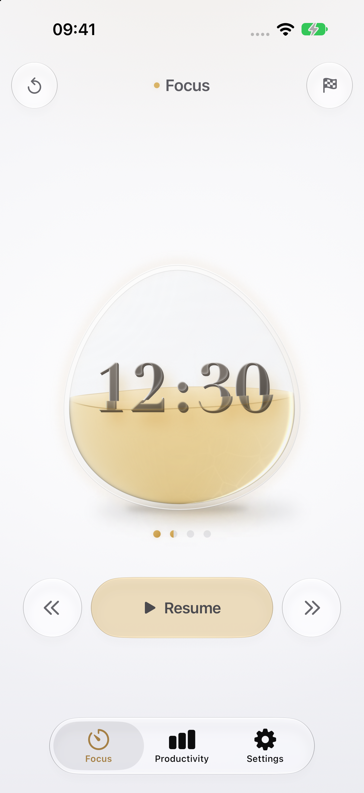
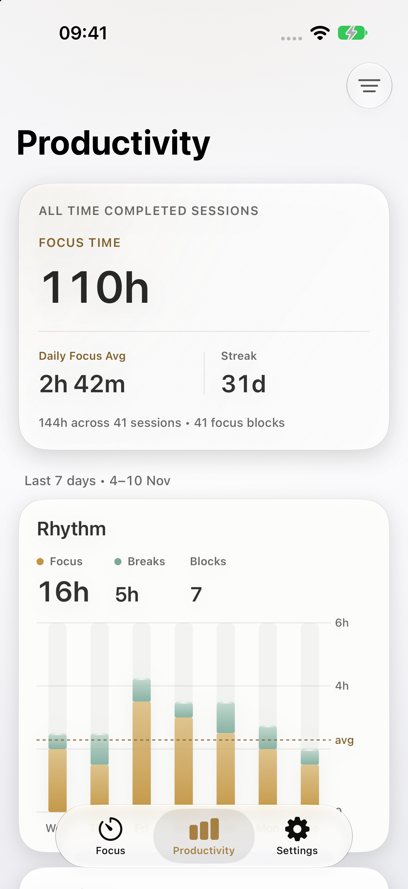
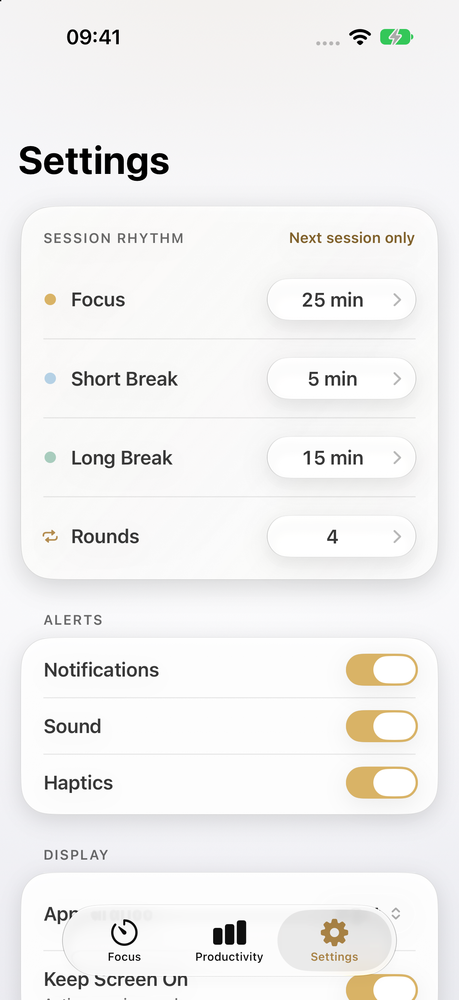
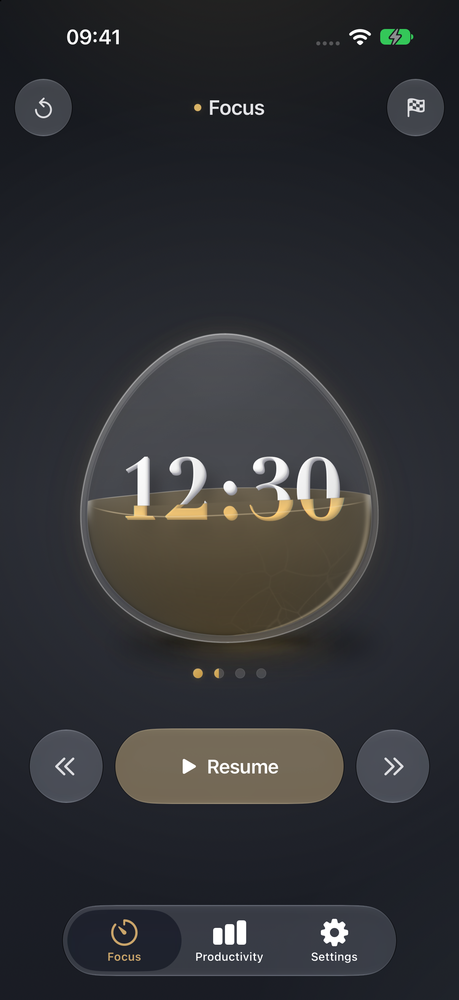
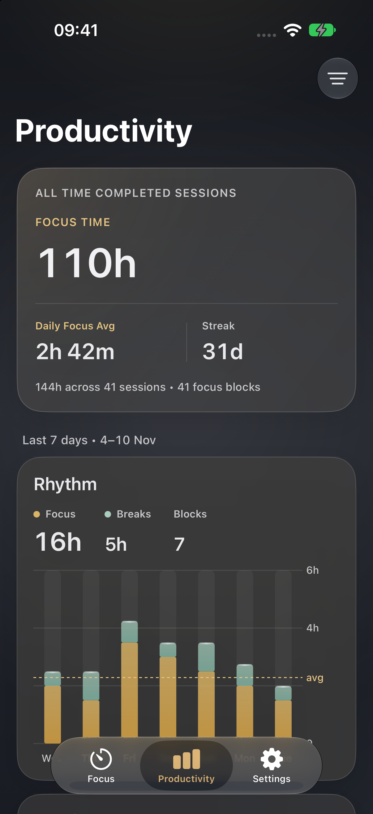
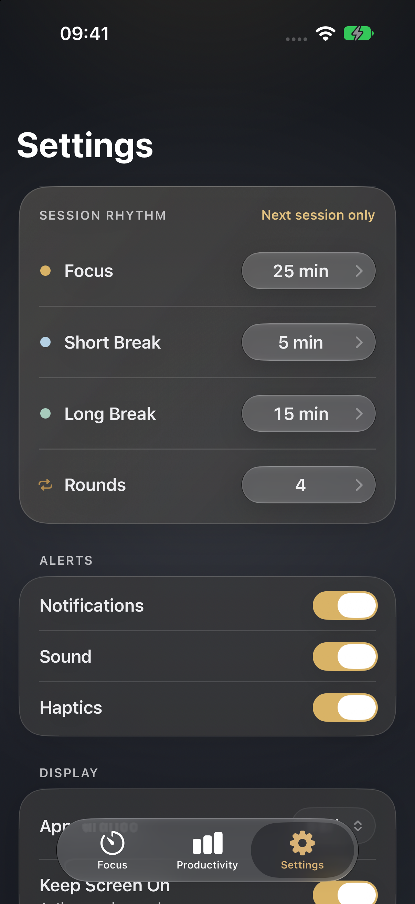
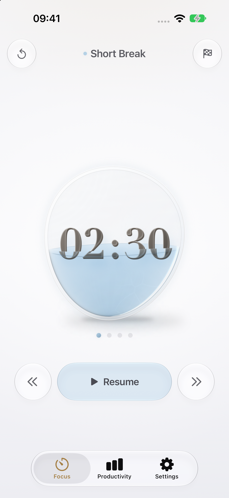
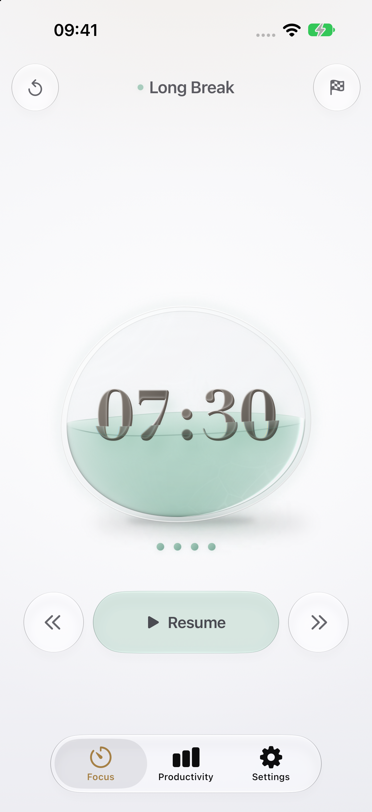
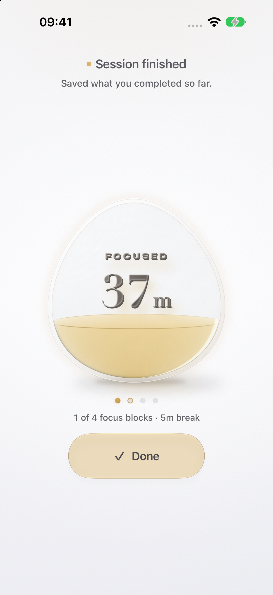

# VibePomodoro

I'm building VibePomodoro, a native iOS Pomodoro timer in SwiftUI. It handles focus and break cycles, restores an unfinished session after relaunch, and records completed sessions in local productivity charts.

I chose a glass vessel as the timer's main visual. It fills as time passes and changes shape between focus, short break, and long break. When the session ends, the same vessel shows how much focus time was recorded.

I decide what the app should do and how it should look, then check the result in the app. AI agents have written much of the code and helped with debugging and tests.

## Screenshots

| Focus | Productivity | Settings |
| :---: | :---: | :---: |
|  |  |  |
|  |  |  |

Captured on iPhone 18 Pro / iOS 27.2 on 10 November 2026. Focus is a paused demo session. Productivity uses generated test history, not my own records. The [full gallery](docs/screenshots/README.md) includes the other phases, chart selection, empty history, and the capture commands. Productivity and Settings continue below the screenshots.

## What I focused on

A progress ring would have been simpler, but I wanted the timer to feel like an object sitting on the page. Focus is an upright amber drop, the short break is a pale bubble leaning upward, and the long break is broad and low. They stand on the same baseline so changing phase doesn't move the whole object around.

| Short break | Long break | Finished early |
| :---: | :---: | :---: |
|  |  |  |

The Didot digits sit inside the glass. Below the surface, the liquid tints and refracts them. That effect uses a Metal shader. The controls stay outside the vessel, and tapping the background hides them for an immersive view. Finishing a session changes the countdown into its focus total in place; Done prepares the next session.

I also wanted the statistics to be explainable. For example, skipping a focus block after five minutes should keep those five minutes without awarding a completed block. Paused time shouldn't count at all. Productivity only includes sessions once they end, including ones finished early. A session crossing midnight contributes time to both calendar days.

The all-time summary puts Focus Time first because longer breaks shouldn't make the main number look better. The Rhythm chart shows focus and breaks across the last seven days, 30 days, or 12 months. Tap a day or month to see its figures and the latest five sessions that started there. Daily Focus Avg excludes days without recorded focus; a streak holds through today until a full day is missed.

Settings uses the same inline wheel for durations and rounds. Those changes apply to the next session, so adjusting a preference doesn't change a timer already running. Appearance, notification, sound, haptic, and screen-awake preferences apply immediately.

| Rhythm setting | Choices |
| --- | --- |
| Focus | 15–90 minutes, in 5-minute steps |
| Short Break | 5 or 10 minutes |
| Long Break | 15, 20, or 30 minutes |
| Rounds | 1–10 |

The default is four 25-minute focus blocks, with 5-minute short breaks and a final 15-minute long break. The session ends after that long break. Start, pause, resume, reset, skip, back, and early completion are available on Focus. The detailed rules and design decisions are in [PRODUCT_VISION.md](PRODUCT_VISION.md).

## Run locally

The deployment target is iOS 26.2. These screenshots were built with Xcode 27.2 (27B52). There are no external package dependencies.

1. Open `VibePomodoro.xcodeproj` in Xcode.
2. Select the `VibePomodoro` scheme and an iPhone simulator running iOS 26.2 or later.
3. Build and run. For a physical device, select your own signing team first.

The liquid shader needs Xcode's Metal Toolchain. If Xcode reports that it is missing, install it with:

```bash
xcodebuild -downloadComponent MetalToolchain
```

To build from the command line:

```bash
xcodebuild \
  -project VibePomodoro.xcodeproj \
  -scheme VibePomodoro \
  -configuration Debug \
  -destination 'generic/platform=iOS Simulator' \
  build CODE_SIGNING_ALLOWED=NO
```

To run the unit and UI tests on the device used for the screenshots:

```bash
xcodebuild \
  -project VibePomodoro.xcodeproj \
  -scheme VibePomodoro \
  -destination 'platform=iOS Simulator,name=iPhone 18 Pro,OS=27.2' \
  test CODE_SIGNING_ALLOWED=NO
```

Use `xcrun simctl list devices available` to find another installed destination. The tests cover session transitions, time accounting, recovery, history aggregation, persistence, reminder feedback, and the main screen flows.

## How it works

One `PomodoroStore` owns runtime state for the app process. The engine handles session transitions; screens display state and send actions. A running timer calculates its remaining time from `Date` and `targetEndDate`. Screen refreshes don't own elapsed time, so backgrounding doesn't depend on the app ticking every second.

```text
VibePomodoro/
├── VibePomodoroApp.swift       Creates the single store
├── ContentView.swift          Shared shell and tab navigation
├── AppIcon.icon/              Icon Composer source
├── Core/
│   ├── Engine/                Session construction and transitions
│   ├── Models/                Settings, snapshots, archives, aggregates
│   └── Store/                 Runtime, persistence, notifications, feedback
├── Screens/
│   ├── Focus/                 Vessels, shader, controls, summary
│   ├── Productivity/          Summary, chart, session list
│   └── Settings/              Rhythm wheels and preferences
└── Shared/                    Reused theme and shell components
```

Storage currently uses UserDefaults. Settings, the active snapshot, completed sessions, and the derived statistics cache have separate write scopes, so changing a setting doesn't rewrite the history. Clearing productivity history removes the archive and cache while keeping the active timer and settings.

The running liquid surface has a 12 Hz refresh budget; digits update once per second. Continuous surface movement stops when paused, off Focus, or backgrounded. Reduce Motion disables it, and Low Power Mode omits the caustic light. The app also has larger-text layouts, Increase Contrast adjustments, and VoiceOver descriptions for chart slots and session rows.

## Current limits

The app runs locally, and each device owns its active timer. The earlier native macOS and Live Activity experiments are archived. Send Feedback and Share App still say Soon.

I haven't measured sustained rendering, heat, or energy use on the target physical iPhone 14 Pro. Physical haptics and lock-screen notification delivery also need device checks. The simulator screenshots don't establish those results, and long-history performance still needs measurement.

SwiftData and iCloud sync aren't implemented. I want the current accounting and storage behavior settled before migrating history. If I add iCloud later, it will cover completed sessions and explicitly selected settings. Active-session handoff and simultaneous timer control across devices are outside the current scope. Imported sounds, advanced analytics, and a possible interface built around animated numerals are also unimplemented; the glass vessels are the current design.
