# Screenshot gallery

These 21 screenshots were captured from the built app on 10 November 2026, using iPhone 18 Pro / iOS 27.2. The PNGs are full-resolution simulator captures with no retouching. Markdown scales them for display.

The session and history data is generated for these previews. The [README](../../README.md) uses a smaller selection; [PRODUCT_VISION.md](../../PRODUCT_VISION.md) explains the design and behavior.

## Capture environment

| Detail | Value |
| --- | --- |
| App source revision | `df83d85be566` |
| Build | Debug, `VibePomodoro` iOS scheme |
| Toolchain | Xcode 27.2, build 27B52 |
| Device | iPhone 18 Pro |
| Runtime | iOS 27.2 |
| Image size | 1206 × 2622 pixels, portrait |
| Appearance | Explicit Light and Dark launch overrides |
| Language and locale | English, `en_US` |
| Status bar | 9:41, Wi-Fi, full battery |
| Storage | Isolated `Qi.VibePomodoro.DocsPreview` UserDefaults suite |
| Notifications | UI-testing mode suppresses permission prompts; Settings uses the `allowed` permission fixture |

The source revision identifies the app code in the captures. Rolling-window labels use the capture date, so running the same fixtures later changes the dates shown.

## Focus and breaks

Each phase is paused halfway through its current step. That keeps the liquid and countdown still for comparison. The outline and color change between phases; the baseline and numeral treatment stay the same.

| Phase | Light | Dark |
| --- | :---: | :---: |
| Focus · 12:30 left in round 2 | 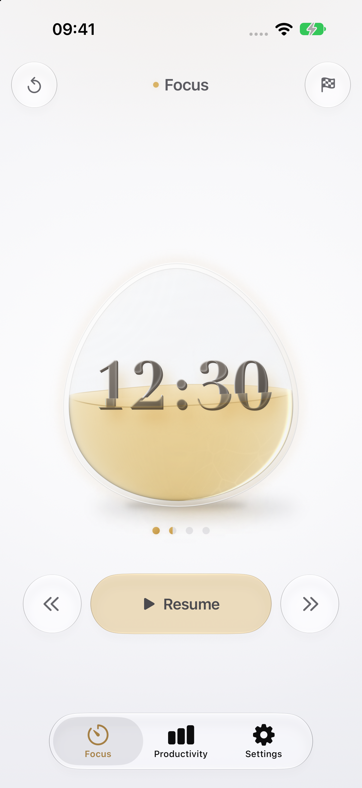 | 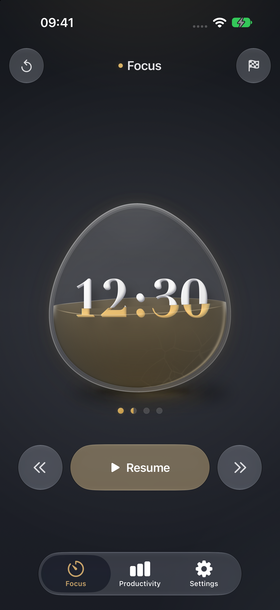 |
| Short Break · 02:30 left after round 1 | 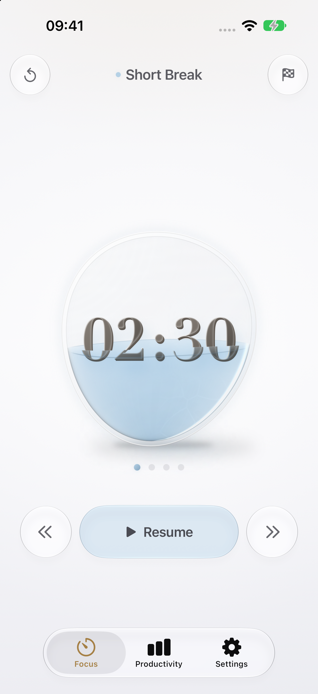 | 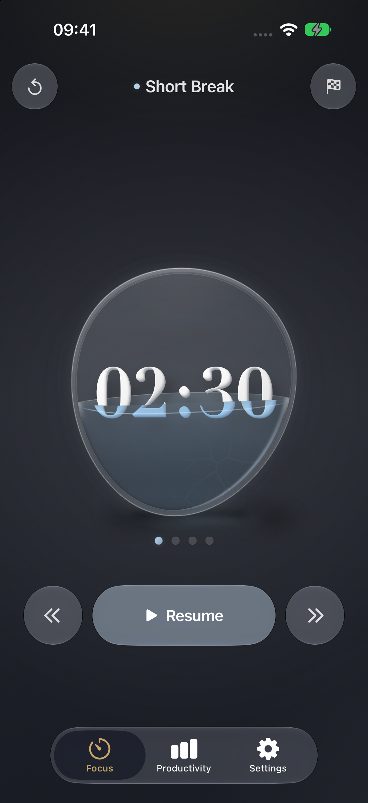 |
| Long Break · 07:30 left after round 4 | 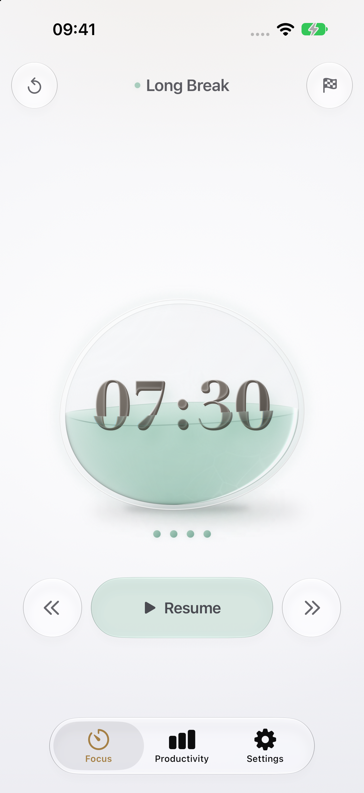 | 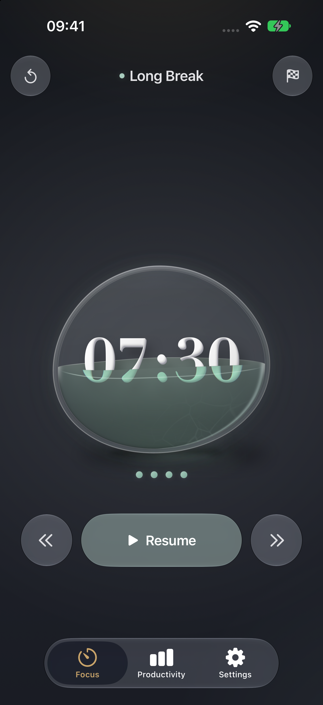 |

The Focus fixture has one complete focus block, one complete short break, and 12 minutes 30 seconds recorded in the second focus block. Short Break has the first focus block complete. Long Break has all four focus blocks and three short breaks complete.

### Finishing and immersion

| Finished early · Light | Finished early · Dark | Immersive · Light |
| :---: | :---: | :---: |
| 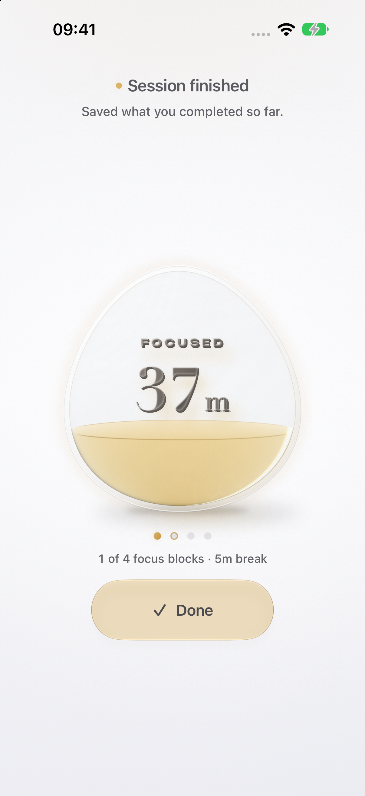 | 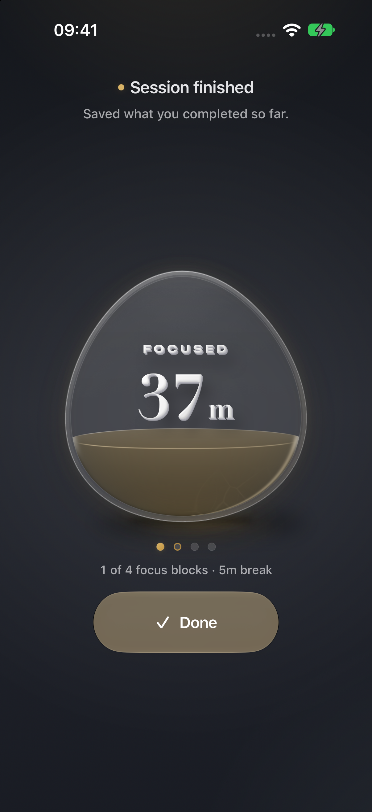 | 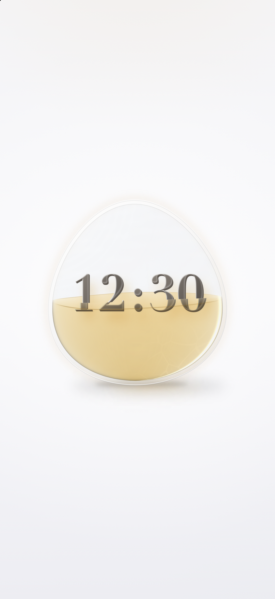 |

The completion images come from choosing Finish early in that second-round Focus fixture. It records 37 minutes 30 seconds of focus, 5 minutes of breaks, and one completed focus block. The compact display reads 37m; VoiceOver keeps the precise duration. The other three focus blocks were not completed.

The immersive image uses the same paused Focus fixture. Tap the background to hide the controls, status bar, and tab bar without moving the vessel. Tap again to restore them.

## Productivity

The populated previews use the existing `long-extreme` UI-testing fixture, which generates 30 recent daily sessions and 11 older monthly sessions. It exercises all three ranges and large totals. Some durations exceed the current picker choices because this is stress-test data.

| Populated · Light | Populated · Dark | Rhythm and sessions · Light |
| :---: | :---: | :---: |
| 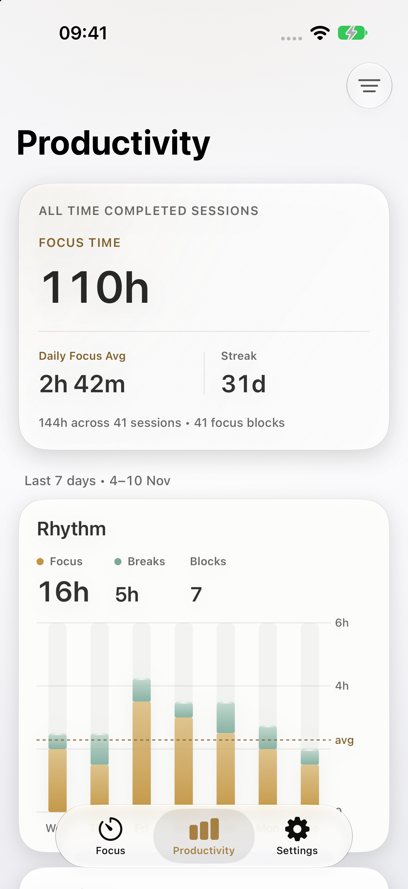 | 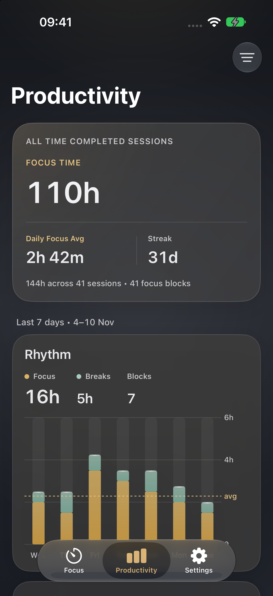 | 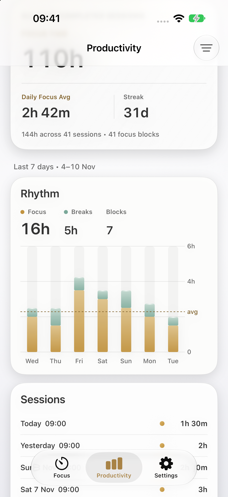 |

The overview images start at the top. The detail image is scrolled to Rhythm and Sessions, leaving part of the all-time card above the screen. The native tab bar floats above the content.

### Ranges and selection

| Month | Year | Selected day |
| :---: | :---: | :---: |
| 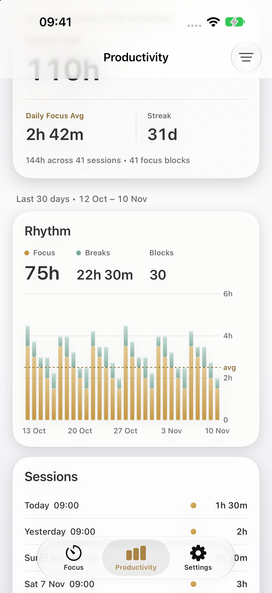 | 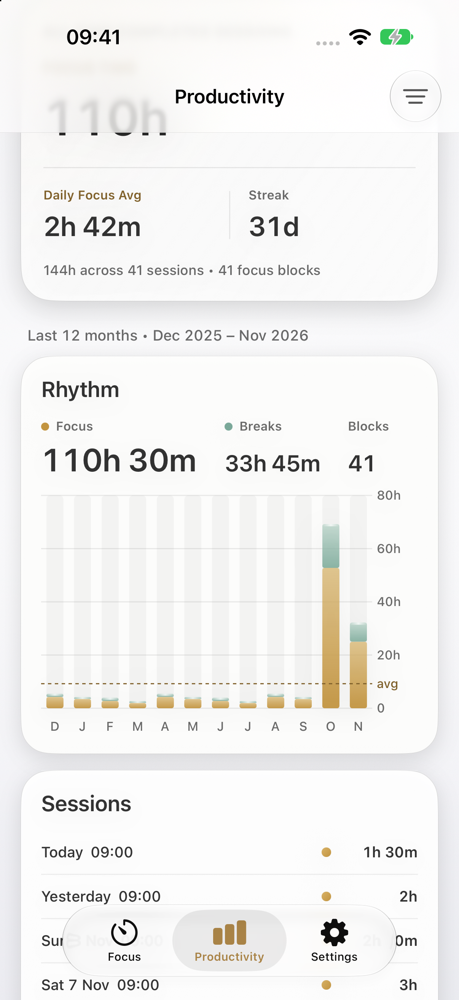 | 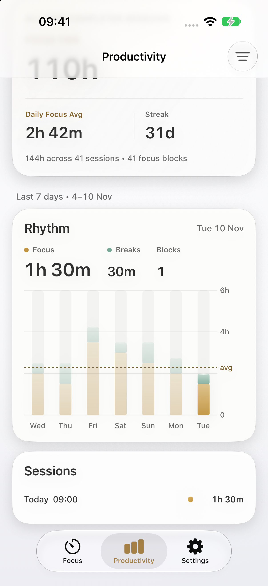 |

These captures keep the same scroll position. Month shows 30 daily bars without background glass columns; Year groups by calendar month.

The selected-day image shows 10 November in Week. Rhythm reads 1h 30m Focus, 30m Breaks, and 1 Block, and Sessions shows the one session that started that day. Changing range clears the selection. The all-time summary keeps its totals.

### Empty history

| Light | Dark |
| :---: | :---: |
| 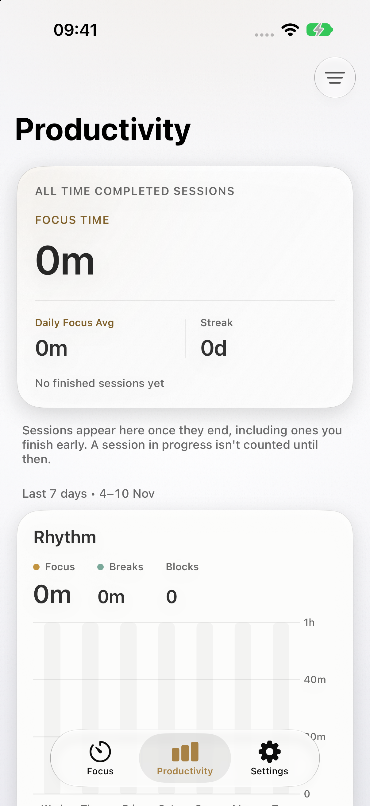 | 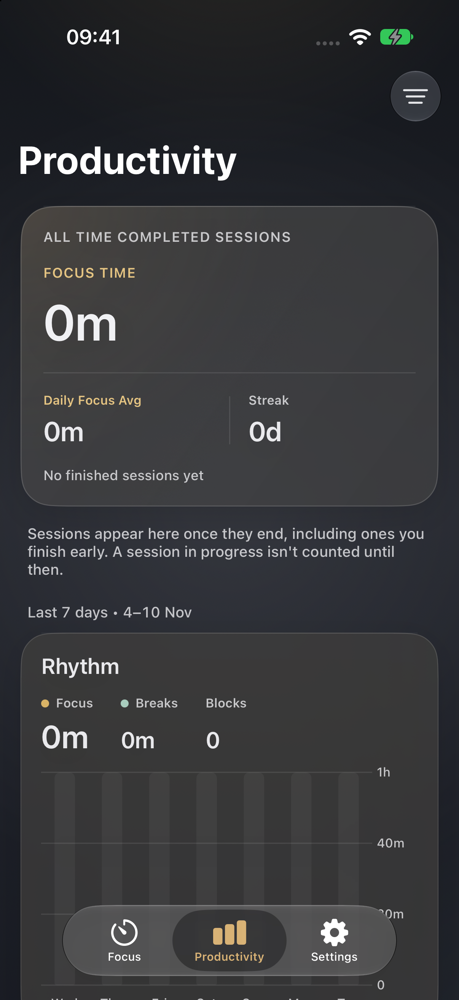 |

These launches reset the preview suite and load no history fixture. Totals and Rhythm values are zero. The Week chart keeps its empty tracks, and the Sessions card is omitted. The note explains that a session appears here once it ends.

## Settings

| State | Light | Dark |
| --- | :---: | :---: |
| Default rhythm and preferences | 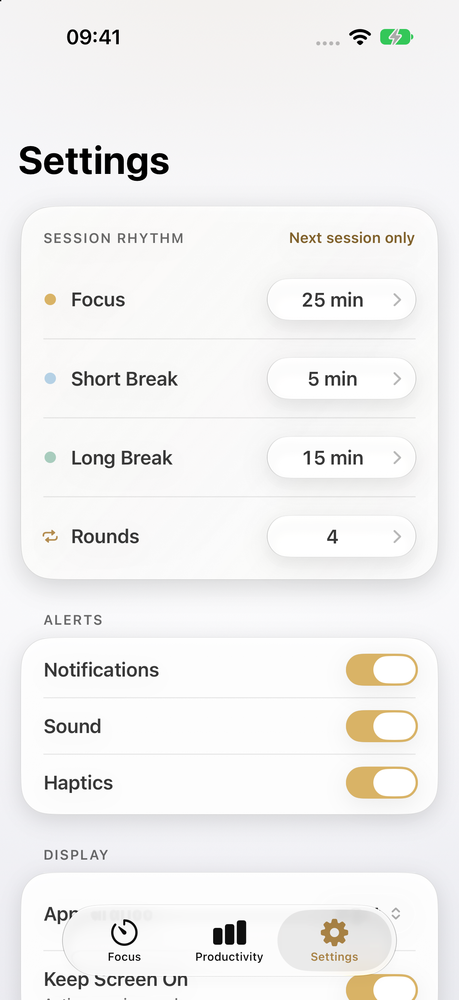 | 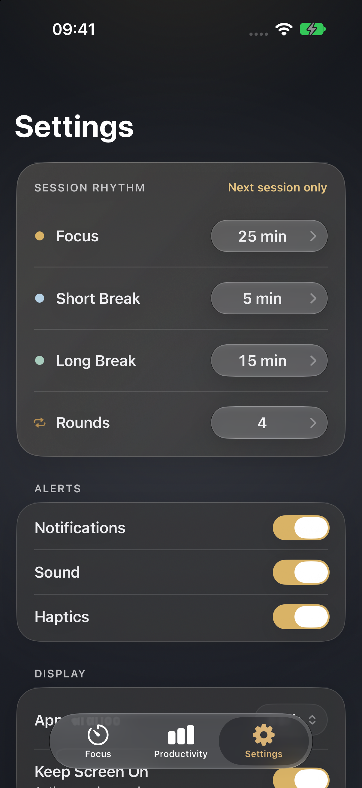 |
| Focus wheel expanded | 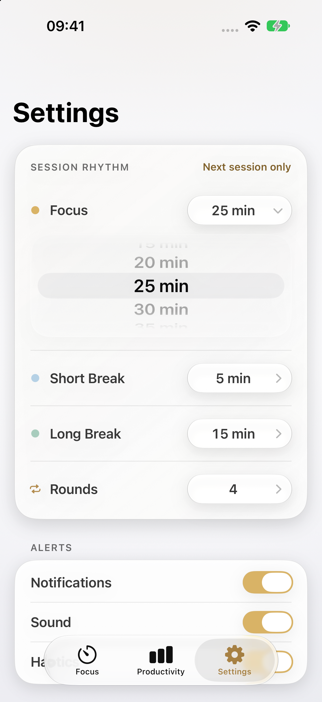 | 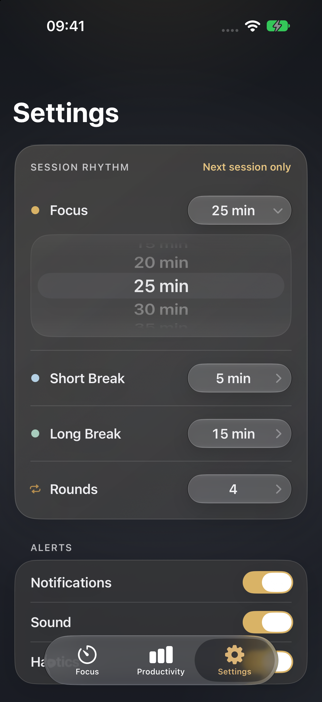 |

Settings shows the default 25 / 5 / 15 minute rhythm and four rounds. The expanded wheel stays at 25 minutes. Alerts are on, notification permission is simulated as allowed, and there is no archived history. Display and Other continue below the screenshot.

## Reproduce the captures

Run these commands from the repository root. Find a simulator with `xcrun simctl list devices available` and set its identifier below. This is the identifier used for the captures; another machine will need its own.

```bash
DEVICE_ID=19E643F3-B20D-4E3F-8877-4FE065C4EAE1
BUNDLE_ID=Qi.VibePomodoro
PREVIEW_SUITE=Qi.VibePomodoro.DocsPreview
```

Build, boot, and install the app. If the device is already booted, skip the `boot` command. The README explains the Metal Toolchain requirement.

```bash
xcodebuild \
  -project VibePomodoro.xcodeproj \
  -scheme VibePomodoro \
  -configuration Debug \
  -destination "platform=iOS Simulator,id=$DEVICE_ID" \
  -derivedDataPath /tmp/VibePomodoro-docs-build \
  build CODE_SIGNING_ALLOWED=NO

xcrun simctl boot "$DEVICE_ID"
xcrun simctl bootstatus "$DEVICE_ID" -b
xcrun simctl install "$DEVICE_ID" \
  /tmp/VibePomodoro-docs-build/Build/Products/Debug-iphonesimulator/VibePomodoro.app

xcrun simctl status_bar "$DEVICE_ID" override \
  --time '9:41' --dataNetwork wifi --wifiMode active --wifiBars 3 \
  --batteryState charged --batteryLevel 100
```

Set the isolated defaults suite before using `--reset-vibe-store`, since that flag clears the selected suite. The helper below also terminates the previous launch and sets the appearance, language, and notification fixture:

```bash
preview() {
  local appearance="$1"
  shift
  xcrun simctl terminate "$DEVICE_ID" "$BUNDLE_ID" 2>/dev/null || true
  SIMCTL_CHILD_VIBE_DEFAULTS_SUITE="$PREVIEW_SUITE" \
  SIMCTL_CHILD_VIBE_NOTIFICATION_PERMISSION=allowed \
  xcrun simctl launch "$DEVICE_ID" "$BUNDLE_ID" \
    --ui-testing --reset-vibe-store "--appearance-$appearance" \
    -AppleLanguages '(en)' -AppleLocale en_US "$@" || return
  sleep 10
}
```

Launch the paused Focus fixture, then capture it. The helper waits ten seconds because shorter waits on this setup sometimes captured a blank launch frame or an appearance transition. Check the saved image before replacing a screenshot, and wait longer if the page hasn't settled.

```bash
SIMCTL_CHILD_VIBE_FOCUS_FIXTURE=focus-2-0.5 preview light
xcrun simctl io "$DEVICE_ID" screenshot docs/screenshots/focus-light.png
```

Repeat with `dark` and the matching output filename. The existing Focus fixture syntax is `<phase>-<round>-<progress>`; an optional trailing `-running` starts the timer rather than pausing it.

| Screenshot stem | Fixture or launch recipe |
| --- | --- |
| `focus` | `VIBE_FOCUS_FIXTURE=focus-2-0.5` |
| `short-break` | `VIBE_FOCUS_FIXTURE=shortBreak-1-0.5` |
| `long-break` | `VIBE_FOCUS_FIXTURE=longBreak-4-0.5` |
| `focus-finished` | Launch the Focus fixture, tap Finish early, confirm, and let the summary settle. |
| `focus-immersive-light` | Launch the light Focus fixture and tap the background outside the vessel. |
| `productivity` | `VIBE_PRODUCTIVITY_FIXTURE=long-extreme`, with `--open-productivity`. |
| `productivity-empty` | No fixture, with `--open-productivity`. |
| `productivity-detail-light` | Launch populated Week in light mode and scroll to Rhythm and Sessions. |
| `productivity-selected-light` | In that detail view, tap the last day, 10 November in this capture. |
| `productivity-month-light` | Open Time Range and choose Month, retaining the detail scroll position. |
| `productivity-year-light` | Open Time Range and choose Year, retaining the detail scroll position. |
| `settings` | No session or history fixture, with `--open-settings`. |
| `settings-picker` | Launch Settings and tap the Focus row. Leave the wheel at 25 minutes. |

With `simctl`, app environment variables need the `SIMCTL_CHILD_` prefix. These commands capture populated Productivity, empty Productivity, and Settings:

```bash
SIMCTL_CHILD_VIBE_PRODUCTIVITY_FIXTURE=long-extreme \
  preview light --open-productivity
xcrun simctl io "$DEVICE_ID" screenshot docs/screenshots/productivity-light.png

preview light --open-productivity
xcrun simctl io "$DEVICE_ID" screenshot docs/screenshots/productivity-empty-light.png

preview light --open-settings
xcrun simctl io "$DEVICE_ID" screenshot docs/screenshots/settings-light.png
```

Each fixture assignment applies to that launch only, so the next clean preview doesn't inherit its history or session. To inspect other permission states, change `allowed` in the helper to `denied` or `notDetermined`. Those states aren't shown in this set.

Check the original images, dimensions, and Markdown paths after capture. Remove the temporary status-bar override when finished:

```bash
xcrun simctl status_bar "$DEVICE_ID" clear
```

Physical haptics, lock-screen notification delivery, heat, and energy use still need device tests.
